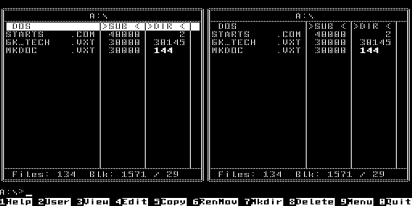
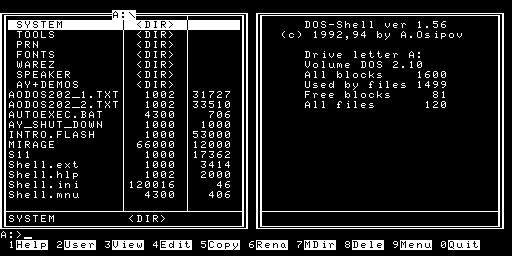

# Два диска БК на общей SD, 5 октября 2026

Linux-стенд `sash@192.168.1.108`; карта 7 988 051 968 байт в слоте
`/dev/disk/by-id/usb-Generic_MassStorageClass_000000001210-0:2` (`/dev/sdf`).
Новая прошивка на плату в этой сессии не записывалась.

## Источники и проверка

| Диск | SHA-256 | C-эталон |
|---|---|---|
| PICO-BK/disks/MKDOS318B.img | `f597efd480bd5978ab9645b3b890d5a9a96beafcd26030d157544958593e58cd` | Файловый менеджер на моделях 0/3 |
| tmp/xxx/Floppies/BK0011M-System.img | `38679b571f3131fbd1240359cdd02eab25bfa54bc950fec59178951bd0e1640a` | DOS 2.10 / DOS-Shell 1.56 на модели 3 |

Каждый источник — 819200 байт, 80 × 2 × 10 × 512. В FAT16 файлы образов
не устанавливаются; КНГМД обращается к сырым секторам логических разделов.
Системный диск 6 отвергает БК-0010-01 сообщением о требовании БК-0011(М).
MK-DOS в C загружен на БК-0010-01 с А16М командой `T0` + Enter.

MK-DOS в HDL загружен из точно подготовленного снимка SD через раздел 5.
Настоящий ВМ1 исполняет resident BIOS, BOS/DISK 327 и ОС через КНГМД/SPI.
CPU 24 МГц; штатные 64 мкс на слово и 8 мкс CSR. Все 16384 байта активной
страницы 5 совпали с C, scroll=001330. 428 чтений SD, 0 записей, 0 ошибок.
Журнал — `two-disks-mkdos-clean-native.log`; независимая сверка сохранённой
VRAM — `mkdos-final-vram-validation.json`.

Системный диск запускает музыкальную заставку ZARDS GROUP перед оболочкой.
Она предлагает СТОП/ESC для выхода. HDL исполняет её без перехвата кода ОС;
тест нажимает настоящий вход STOP ВМ1, после чего продолжается загрузка.
Время disk-word/CSR не ускоряется. Финальный HDL cold boot прошёл:
1598 чтений SD, 0 записей, 0 ошибок; все 16384 байта активной страницы 5
и scroll=001336 совпали с C. Журнал — two-disks-system-final-native.log;
общая проверка обоих дисков — two-disks-native-validation.json.

Ранние попытки без STOP были остановлены
на заставке; ускорение дискеты не устраняло ожидание STOP.

В C callback RESET сбрасывает банк памяти; в HDL банк сохраняется. Это
изменяет исполнение заставки, поэтому C сразу дошёл до DOS-Shell.
Диагностическая C-копия с сохранением банка показала ту же заставку,
что HDL. RTL ради обхода заставки не менялся. Независимые исходники
[BKBTL ResetDevices](https://github.com/nzeemin/bkbtl/blob/master/emulator/emubase/Board.cpp)
и [Bk11MemoryManager.init](https://github.com/3cky/bkemu-android/blob/master/lib/src/main/java/su/comp/bk/arch/io/memory/Bk11MemoryManager.java)
сохраняют страницы при программном RESET. Исправление C RESET/STOP не
входит в данную запись SD; после загрузки сравнивается весь экран ОС.

Проверки нового BIOS: `results-bios-logical.json` — начальные назначения
6/5 RO, редактирование через пропуск контейнера 4 и сохранение BK.SET;
`results-ebr-bios.json` — десять повреждённых цепочек отвергнуты до lock ПЗУ.
Остальные файлы и байты тестовых SD проверены на неизменность.

## Разметка и сохранение Пълдина

| Раздел | Начало LBA | Секторов | Назначение |
|---|---:|---:|---|
| 1 | 2048 | 32768 | Общая FAT16 |
| 2 | 34816 | 1440 | Пълдин, сохраняется |
| 3 | 36864 | 2880 | Пълдин, сохраняется |
| 4 | 40960 | 7744 | Расширенный контейнер 0F |
| 5 | 43008 | 1600 | MK-DOS 3.18 |
| 6 | 47104 | 1600 | DOS 2.10 / DOS-Shell 1.56 |

EBR: 40960 и 45056. Начальный BK.SET: модель 3, 4 МГц, MONO,
A=6 RO, B=5 RO, C/D=OFF. При выборе модели 0 BIOS назначает A=5/B=6 RO;
МК-DOS в режиме 0 запускается `T0` + Enter. В модели 3 для MK-DOS поменяйте
A/B местами в BIOS; BOOT WITHOUT SAVE не меняет карту.

`two-disks-prepared.json` фиксирует все payload SHA-256 и файлы Пълдина.
Их исходные записи каталога, цепочки FAT и содержимое сохранены.
Новые файлы: LOADERBK.BIN, BK00.ROM…BK04.ROM, BK.SET.
Прежний 337-байтовый LOADERBK сохранён в LDRBKOLD.BAK;
481-байтовый Пълдиновский LOADER.BIN сохраняется.

Резервные области — `*-before.bin.gz`; полные оригиналы находятся
в `/home/sash/Work/FPGA/bk-mkdos-sd-20261005/` на Linux. В новой области
есть старые неразмеченные данные; их замена разрешена владельцем,
вся область также сохранена в extended-before.bin.gz.
Существующее несоответствие метки P601 BOOT записи root не исправляется;
`fsck.fat -n` только читает. Обе FAT и цепочки файлов проверены.

`tools/write_sd.py` сверяет устройство, ёмкость, резервные данные и успешный
журнал HDL, привязанный к хешу подготовленного SD. Записывает и проверяет
секторы дисков/EBR, затем файлы и MBR. Проверка копии карты прошла:
`writer-offline-test.json` — каждый байт вне подготовленных областей в
первых 24 МиБ сохранён, физическое устройство не открывалось.
Физическая запись завершена: `sd-written.json` содержит written=true.
Оба диска БК прочитаны обратно и совпали с исходниками. Разделы 2/3
Пълдина до и после имеют одинаковые SHA-256; FAT16 полностью совпала
с подготовленной версией, сохранившей его файлы и цепочки кластеров.
Независимое повторное чтение MBR/EBR/FAT16 — `sd-final-readback.json`;
`fsck-final.log` показывает только прежнее несоответствие метки тома.
`final-sanity.json` подтверждает сверку 139 файлов выпуска и отчётов.

## Прошивка

[hardware-lcd-models-disks-20261005](../../../releases/hardware-lcd-models-disks-20261005/README.md)
содержит BIOS с двумя EBR/логическими дисками, 7752 из 8192 байт.
JED SHA-256: `0a782993f09c710d348ccb1ed5c7220a21ed2f190ab82e25b29896e9e8128a5e`.
MAP/PAR/TRACE: 0 setup/hold ошибок, 25/26 EBR, 6310/6864 LUT,
CPU 29.807 ≥ 24 МГц, PAL 67.760 ≥ 64 МГц. Синтезированные ПЗУ и буферы
проверены на официальных моделях Lattice. Физический запуск новой версии
и проверка обеих ОС на плате остаются отдельным шагом.
